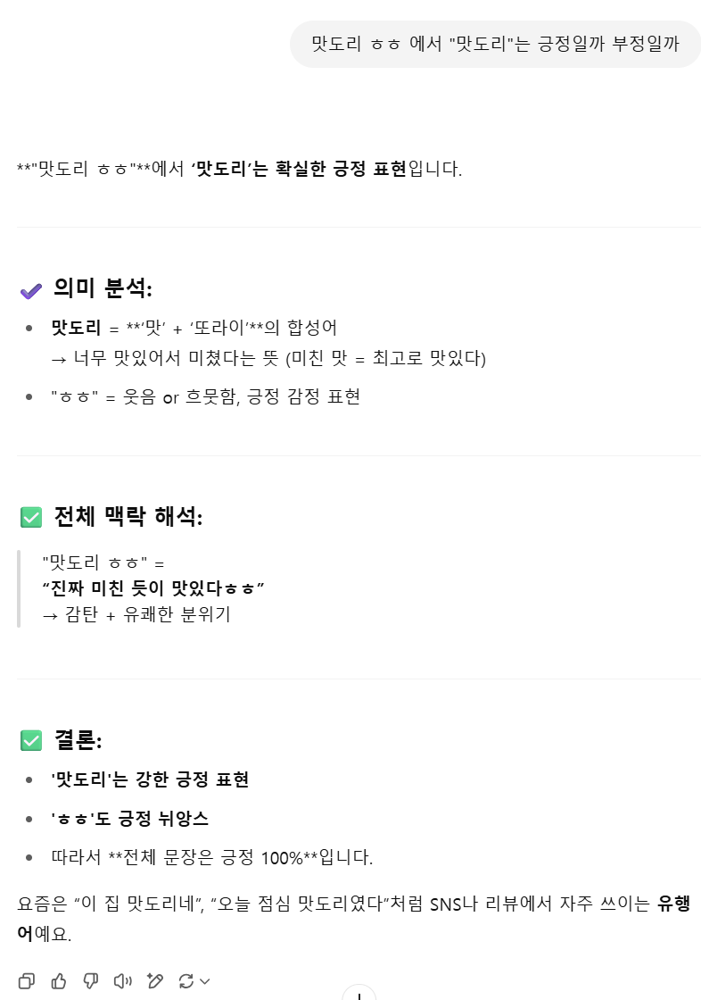
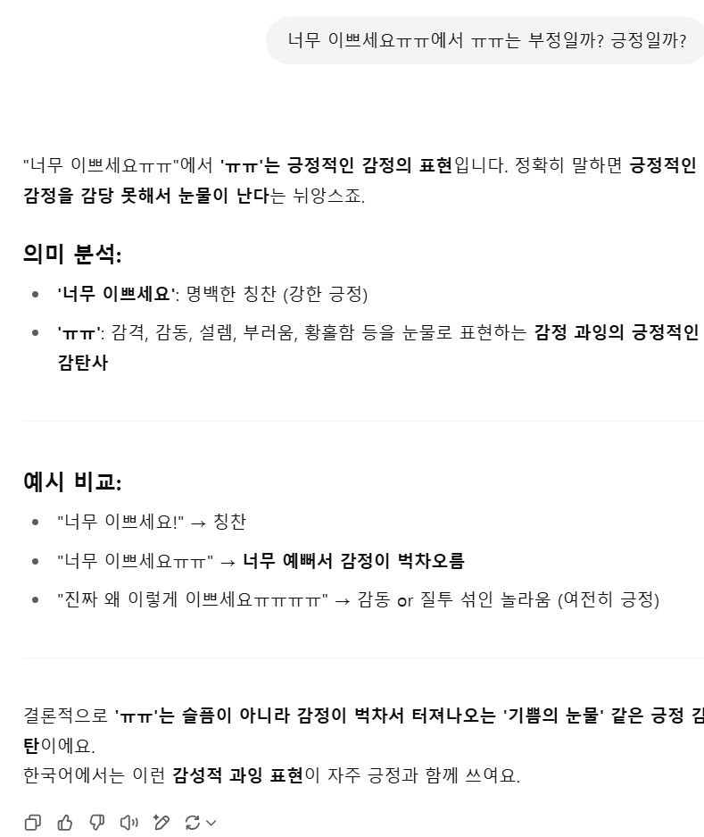
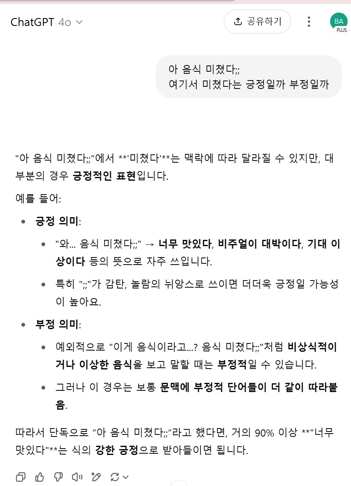
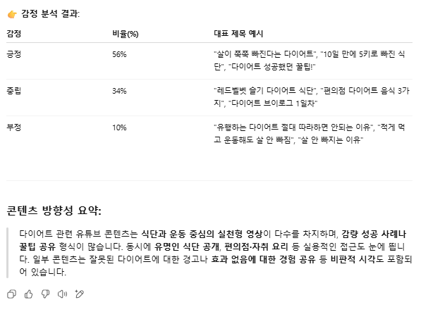
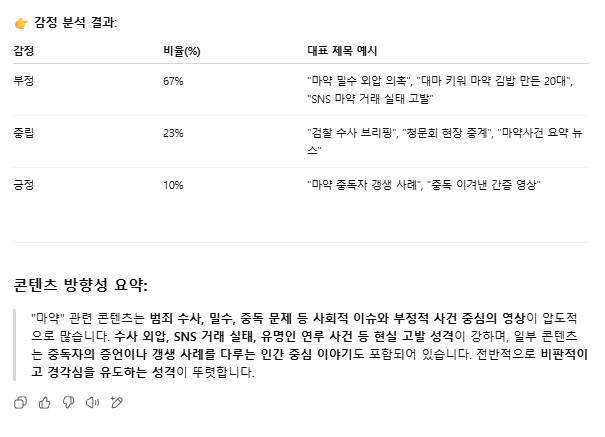
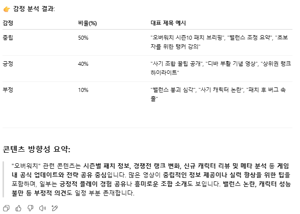

# TitleMind: 유튜브 제목 기반 트렌드·감정 자동 분석 GPT

키워드 하나를 입력하면 관련 유튜브 영상 제목 30개를 **실시간으로 수집**해 단어 빈도, 감정 분포(긍정·중립·부정), 콘텐츠 방향성 요약을 표로 돌려주는 커스텀 GPT입니다.

- **기간**: 2025.06 ~ 2025.07
- **수업**: 2025-1 커뮤니케이션세미나 (개인 프로젝트)
- **GPT 링크**: [TitleMind: 유튜브 콘텐츠 분석 GPT](https://chatgpt.com/g/g-6840fac3dc308191b4d74084929e1bd0-titlemind-yutyubeu-kontenceu-bunseog-gpt)
- **도구**: ChatGPT GPTs, Actions (OpenAPI 3.1), SerpAPI YouTube 검색

## 왜 만들었나

유튜브 제목은 시청자가 가장 먼저 보는 정보이고, 짧은 문구에도 제작자의 의도와 이슈의 분위기가 담깁니다. 그런데 기존 분석 도구는 조회수나 댓글 통계에 집중되어 있어, 마케터나 기획자는 제목 흐름을 보려면 직접 검색하고 감으로 판단해야 했습니다.

TitleMind는 이 과정을 **키워드 입력 → 수집 → 전처리 → 분석 → 요약**의 한 번의 대화로 자동화합니다.

## 작동 방식

```
키워드 입력
   │
   ▼
SerpAPI /search.json (engine=youtube)  ← GPT Actions로 호출
   │  영상 제목 최대 30개
   ▼
전처리: 괄호·이모지·특수문자 제거, 불용어 제거, 입력 키워드 제외
   │
   ├─▶ 단어 빈도 상위 30개 (표)
   ├─▶ 제목별 감정 분류 → 긍정·중립·부정 비율 + 대표 제목 (표)
   └─▶ 콘텐츠 방향성 요약 (300~400자, 중립 문체)
```

| 구성 요소 | 설정 | 이유 |
|---|---|---|
| Actions | 사용 (SerpAPI) | 모델이 지어낸 제목이 아니라 실제 검색 결과만 분석하기 위해 |
| Knowledge | 사용 안 함 | 고정된 감성사전은 '맛도리', '미쳤다', 'ㅠㅠ' 같은 신조어·구어체를 제대로 해석하지 못함 |
| 웹 검색, 코드 인터프리터 | 사용 안 함 | 분석 근거를 API 결과 하나로 제한해 재현성 확보 |

전체 지침은 [gpt/instructions.md](gpt/instructions.md), Actions 스키마는 [gpt/openapi_schema.json](gpt/openapi_schema.json)에 있습니다.

## 만들면서 해결한 문제

**1. API가 실패하면 GPT가 제목을 지어냈다**
처음에는 YouTube Data API를 썼는데, 응답이 불안정했고 호출이 실패해도 GPT가 그럴듯한 가짜 제목을 만들어 분석했습니다. 구조화된 결과를 안정적으로 주는 SerpAPI로 바꾸고, `no_cache` 옵션으로 최신 결과를 받도록 했습니다. 실패할 때는 정해진 문장("API 응답 실패로 분석이 중단되었습니다.")만 출력하도록 지침에 명시했습니다.

**2. 검색 키워드가 항상 빈도 1위였다**
검색 결과 제목에는 입력 키워드가 거의 다 들어가서, 빈도 분석이 매번 키워드 자체로 채워졌습니다. 전처리 단계에서 입력 키워드를 무조건 빼도록 바꿔 실제 콘텐츠 단어가 드러나게 했습니다.

**3. 감성사전으로는 유튜브 말투를 못 읽었다**
'맛도리', '너무 이쁘세요ㅠㅠ', '아 음식 미쳤다;;' 같은 표현을 GPT 문맥 판단으로 테스트한 결과, 단어 하나가 아니라 문장 전체로 감정을 판단해 자연스럽게 분류했습니다. 그래서 외부 감성사전 없이 문맥 기반 분류로 확정했습니다.

<p>



</p>

## 테스트 결과

성격이 다른 키워드 3개로 테스트했을 때, 키워드마다 감정 분포와 프레임이 뚜렷하게 다르게 나왔습니다.

| 키워드 | 긍정 | 중립 | 부정 | 주요 프레임 |
|---|---|---|---|---|
| 다이어트 | **56%** | 34% | 10% | 식단·운동 실천, 감량 성공 사례 |
| 마약 | 10% | 23% | **67%** | 수사·밀수·유명인 연루 등 범죄·사회 문제 |
| 오버워치 | 40% | **50%** | 10% | 패치·랭크·메타 등 정보 전달 |

<p>



</p>

## 한계와 개선 아이디어

- **제목만 분석**: 제목이 짧거나 낚시성이면 실제 콘텐츠·반응과 어긋날 수 있습니다. YouTube Data API v3로 영상별 상위 댓글을 함께 수집해, 제목(제작자 의도)과 댓글(시청자 반응)의 감정을 비교하는 기능으로 확장할 수 있습니다.
- **표본 크기**: 키워드당 30개 제목이라 비율이 몇 개 제목에 따라 크게 움직입니다.
- **감정 분류의 검증**: 문맥 기반 분류를 사람이 직접 라벨링한 결과와 비교해 정확도를 수치로 확인하지는 못했습니다.

## 직접 만들어 보려면

1. ChatGPT에서 GPT를 새로 만들고 [gpt/instructions.md](gpt/instructions.md)의 내용을 지침에 붙여넣습니다.
2. Actions에서 [gpt/openapi_schema.json](gpt/openapi_schema.json)을 스키마로 넣습니다.
3. Authentication을 **API Key / Custom / 파라미터 이름 `api_key`** 로 설정하고 본인의 [SerpAPI](https://serpapi.com) 키를 넣습니다. 키는 스키마나 지침에 직접 쓰지 않습니다.
